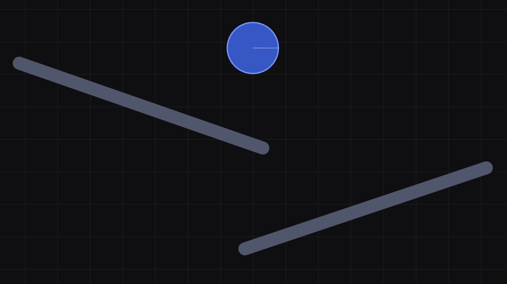
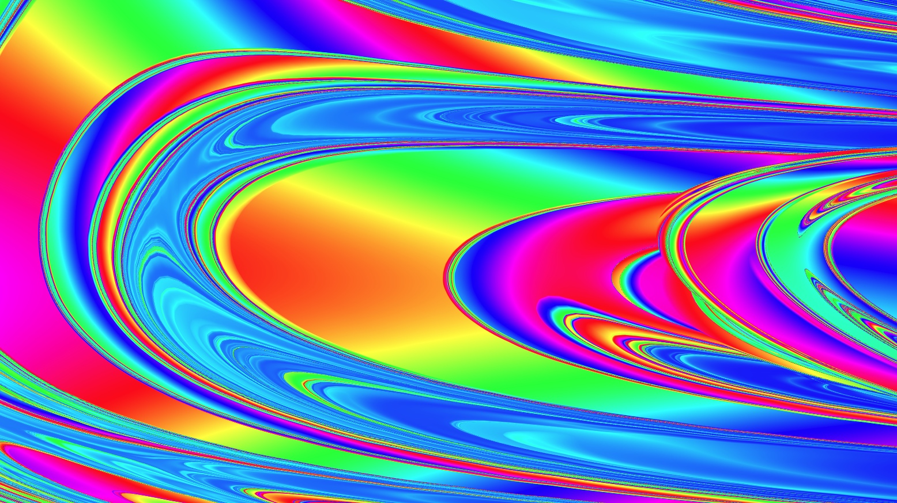
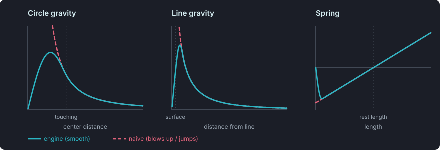

# [chaosaccelerator.com](https://chaosaccelerator.com)

Live at https://chaosaccelerator.com

Build a small physics scene with the simple web UI. Then click Fractal-ize and
explore the resulting map!

<p align="center">
  
  
</p>

The map (an initial conditions map) is made by running the simulation you built
millions of times, each with slightly different initial conditions. When you
build the scene, you pick two values in it as the two inputs, X and Y. For
example, the starting location of an object maps cleanly to X and Y. The X and
Y coordinates of each pixel on the map fill in those two inputs, which defines
the simulation to run for that pixel. You also pick an output, such as the
final height of a moving object. When a pixel's simulation finishes, its output
value is mapped to a color, and the pixel is drawn in that color. The same is
done for every pixel in view to produce often stunningly complex maps.

## Performance

The goal of Chaos Accelerator is to let you explore the map in real time. That
means running millions of simulations per second. This is done with hardware
acceleration, by running the simulations on the GPU with WebGL2. When you click
Fractal-ize, a large JavaScript code generator writes GLSL shader code for your
scene. That code runs on the GPU, one simulation per pixel, all in parallel.
Other optimizations are also used, like drawing a low resolution version first
and refining it, reusing past work when possible, and removing unused code
from the shader. For sufficiently simple scenes, high resolution rendering
should take under 100ms even on low performance devices. But for larger scenes
and higher precisions, running millions of simulations can cause noticeable lag.

## Precision

The web app lets you pan and zoom around the map. Once you zoom in far enough,
neighboring pixels start from values so close together that 32-bit floats
can't tell them apart. On top of that, the small rounding errors from each step
grow quickly in a chaotic scene. Together these make the map blocky and
inaccurate. WebGL2's shader language (GLSL ES 3.00) only has 32-bit floats, not 64
or more. So to allow higher levels of zoom the app uses floating-point
expansions (aka multi-float arithmetic). Each number is stored as the sum of
two, three or four 32-bit floats, and the math is built from error-free
transformations like TwoSum and TwoProduct. Up to quad-float (four 32-bit
floats, around 28 significant digits) is supported.

Supporting double-float, triple-float and quad-float adds a lot of extra
complication to the GLSL code and the code that generates it. But more
importantly it makes every math operation much more expensive. Here is how many
32-bit float adds and multiplies it takes to do one multiply in the generated
shader code:

```
precision       float ops per multiply
float32         1
double-float    18
triple-float    73
quad-float      157
```

The GLSL code also gets very large. This can cause the one time compile
time to take so long that some browsers will disable WebGL for the site
altogether.

## Modes and features

- Planet Mode
  - Every object pulls on every other with inverse-square gravity
  - Allows simulation of the three-body problem and more
- Uniform gravity (Planet Mode off)
  - Objects are pulled down toward the bottom of the screen
- Edge handling
  - You can pick from 3 choices what happens when an object reaches the edge
    of the scene
  - Sticky Edges: the simulation stops at the edge
  - Pac-Man Warp: the object comes back in from the opposite edge
  - Infinite Space: there are no edges
- Friction can be changed. It works like drag, so at 10% an object loses 10% of
  its speed every second
- Collisions can be turned on and off
- Color blind palettes in Settings
- Sounds
  - Different sounds play when objects bounce, hit a sticky edge, warp through
    a portal, and sometimes when they overlap
  - When several simulations are compared in the Inspect card, each one gets
    its own pitch
  - Sound is muted by default


## Tools for exploring and understanding the map

- Inspect card
  - Play back the simulation for any point on the map
  - Inspect a line, which places 30 inspection points along it (adjustable), or
    a grid of points
  - With more than one point inspected, the separation plot shows how far apart
    the runs drift on a log scale. Its slope estimates the largest Lyapunov
    exponent, shown as λmax
- Analysis card
  - Rose plot: which directions the edges in the visible map run
  - Value distribution: a histogram of the output values (colors) in the
    visible map
  - Topography: counts of ridges, valleys, saddles and flat areas. Hover and
    click to see them highlighted on the map
- Display modes
  - Laplacian, Contours, FTLE and Gradient run extra simulations for every
    pixel, starting from points right next to it, and color the map by how
    much the result changes between them
  - FTLE (finite-time Lyapunov exponent) shows how fast those neighboring
    simulations move apart
- Map Evolution
  - With Playback on, the map updates in real time as every pixel's simulation
    plays forward in lockstep. Each pixel's state is kept between frames, so
    moving forward only computes the new steps instead of starting from scratch
    each time
- Movie
  - Place keyframes at different views (pan/zoom) with different step counts
    and even different friction values
  - Once "Done" is clicked, the movie finds a smooth path between the keyframes
    and renders a video at the resolution you choose that can be downloaded and
    shared
  - The Movie card can also export raw data for external analysis
- Challenges
  - Games only for advanced users to attempt

## Share

The entire scene you build, plus your pan/zoom and more, is encoded in the URL
fragment (the part after the #). Browsers never send the fragment to the
server. If you want to save or share a scene, share the URL. The fragment has
no user identifier of any kind. It only describes the state of the app, and
it's designed for sharing and saving. The builder also keeps your current scene
in this browser's local storage so it's still there next time, but a link is
the only way to keep more than one scene or move one to another device.

## Easter egg

The landing page has a theme switch in the bottom left to show off what amazing
things can be done with WebGL.

## Keeping the map continuous

The initial conditions map turns out to be an excellent tool for finding
small inaccuracies in the physics simulation code, which usually show up as a sharp
color edge that shouldn't be there. I have worked hard to get rid of these
false discontinuities, so that the real structure from the physics is easier to
see.

For example, events that happen part way through a time step would cause false
discontinuities if calculated naively. Let's say two objects collide 20% of the
way into a step. The naive approach is to treat the collision as happening on a
step boundary. Then as the starting point moves smoothly across the map, the
collision time jumps by a whole step at a time, which shows up as bands on the
map. My code instead finds when in the step the collision happens and splits
the step into two parts there, doing the math once before the bounce and once
after. Each of these events is handled at the moment it happens, even part way
through a step:

- collisions
- edge sticking
- portal warps

### Smooth force laws

Force laws can cause false discontinuities too. For example, let's say you have
two circles at the same height connected at their centers with a spring, with
collisions turned off. The two circles are moving straight toward each other.
Once the spring is shorter than its rest length, Hooke's law pushes the right
circle to the right, harder and harder as it gets closer to the other circle.
But once the circles pass each other, the force instantly flips to push this
circle left. That instant jump causes an undesirable edge on the map. A real
spring can't be squashed down to zero length, so real life doesn't say what
should happen here anyway. I changed the force curves for springs and gravity
so they smoothly go to 0 as the distance goes to 0. Gravity is normal
inverse-square until objects touch, and springs follow Hooke's law until they
are squashed to an eighth of their rest length. For gravity this is the same
idea as gravitational softening in N-body simulations.



## No server

This entire web app is a static website. All of the computation is done on
your local machine. Once your browser downloads the site's files, the server is
done and the rest is done on your end. The URL is constantly changing as the
fragment updates to describe your scene, but the fragment never gets sent to
the server.

## Keyboard shortcuts

Builder and map
- `k` or `space` Play / Pause
- `m` Mute
- `x` Speed
- `r` Reset
- `,` Settings
- `?` All shortcuts

Builder
- `c` + Circle
- `l` + Line
- `p` + Portals
- `a` + Anchor
- `h` + Hinge
- `s` + Spring
- `e` Set Velocity
- `i` Set Input (Location)
- `v` Set Input (Velocity)
- `o` Set Output
- `b` + Basin
- `delete` Delete selected object
- `g` Planet Mode
- `u` Collisions
- `1` Sticky Edges
- `2` Pac-Man Warp
- `3` Infinite Space
- `f` Fractal-ize

Map
- `i` Inspect
- `a` Analysis
- `d` Display
- `e` Evolution
- `v` Movie
- `c` Challenges
- `q` Inspect (Point), on touch and small screens
- `w` Inspect (Line)
- `n` Nerd Stats
- `z` Color Zoom
- `s` Low Saturation
- `h` Reset View
- `t` Measuring Tape (esc to cancel)
- `0` Precision: Auto
- `1` Precision: float32
- `2` Precision: double-float
- `3` Precision: triple-float
- `4` Precision: quad-float
- `5` Standard
- `6` Laplacian
- `7` Contours
- `8` FTLE
- `9` Gradient
